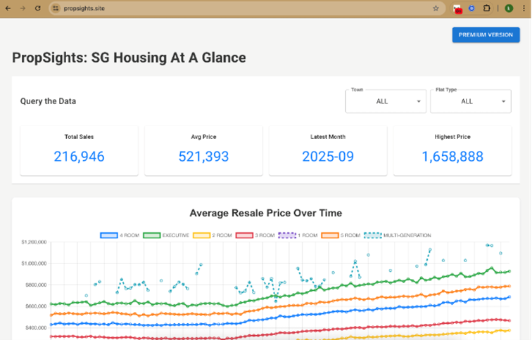
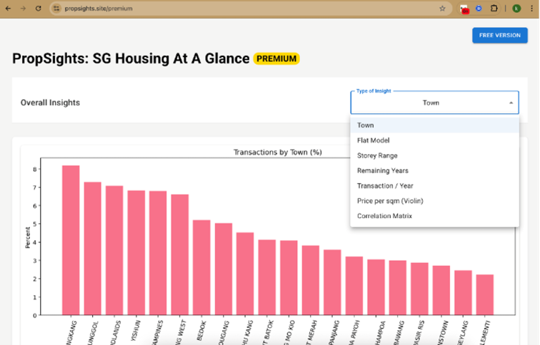
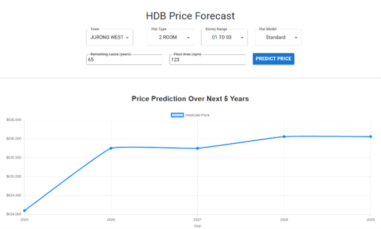
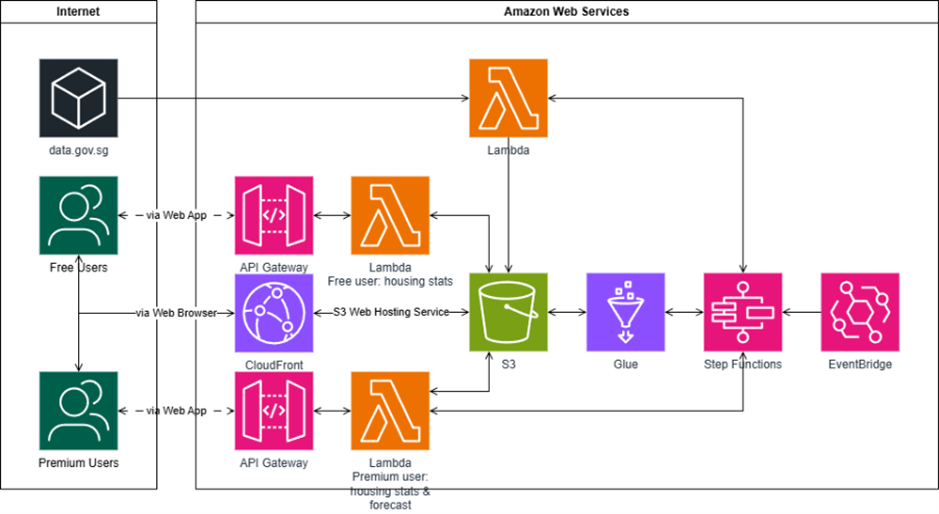
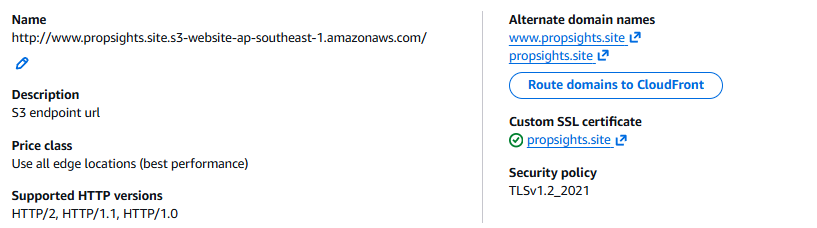
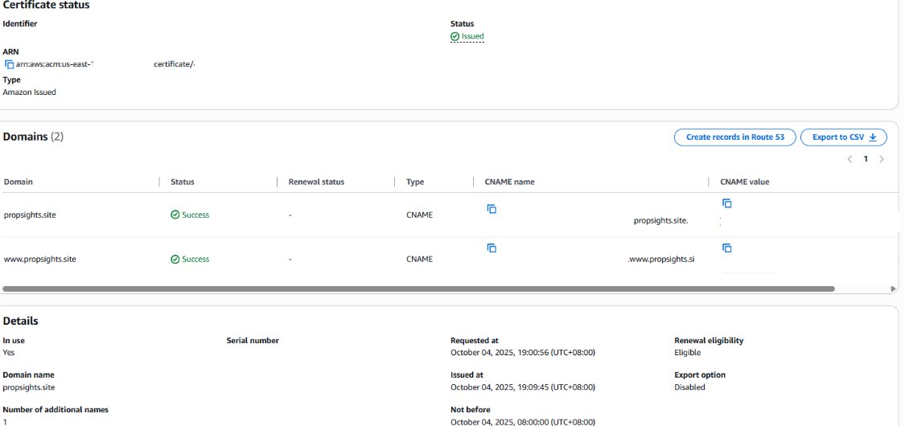
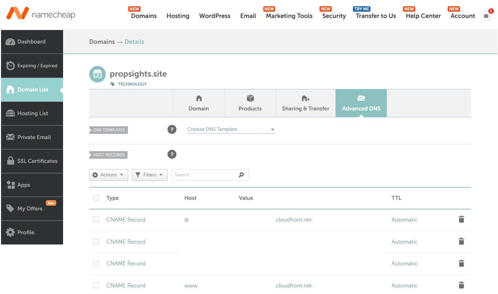
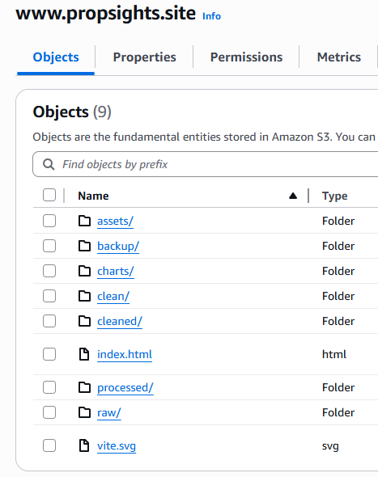
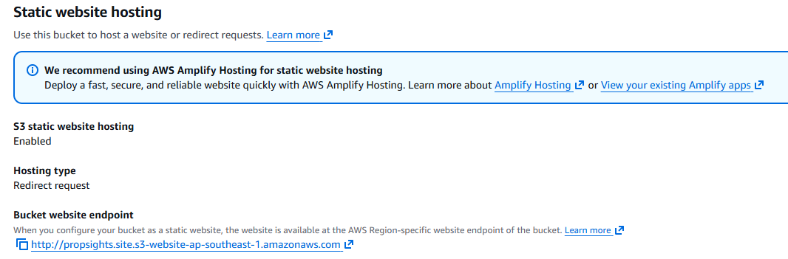

# Resale-Propsights
---
AWS Hosted Web app for Realtors, Real estate buyers and sellers - Making housing price data transparent and actionable.

### Overview
HDB flats constitute the majority of Singapore’s housing stock, and the resale market plays a crucial role in shaping affordability, property investment decisions, and housing policies. Recognizing the public’s strong interest in HDB market analytics, we present PropSight - The HDB Lens, a cloud-based Software-as-a-Service (SaaS) platform designed to analyze HDB resale prices.

### Group Members
- Amos Kwok Chun Fung
- Davin Hong Hao Yang
- Tay Kar Hwee
- Teo Pei Sheng Nicholas
- Yew Jing Hui

## Intro
---
In the current Singaporean public housing market, access to clear and synthesized resale flats’ pricing data may be difficult. This "information gap" can manifest as challenges for resale buyers and realtors. 

The application is hosted on S3 bucket static hosting for speed and cost, while an API Gateway and Lambda pair exposes lightweight JSON aggregates so the user can filter by town, price range, month and remaining lease. There are two versions of the app: free and premium.

Free version:


Premium version:


Price forecast using custom proprietary algorithms:


### AWS Architecture


List of resources:
- React Web App
- API Gateways
- S3
- Cloudfront
- Lambda & Event Bridge
- Glue for ETL


Cloudfront distribution with custom SSL certificate for HTTPS enforcement:


AWS Certificate Manager custom SSL certificate with dedicated CNAME records:


To utilize a professional domain for our business, we purchased a custom domain from namecheap. CNAME records for propsights.site are configured to point towards the AWS Cloudfront Distribution:


Using two S3 buckets:
1. Static hosting the site files (www.propsights.site)

2. Second S3 Bucket (propsights.site) serves as Redirector 


#### 1. Preparing your branch
Preparing to work on your branch:
```python
# First clone the repository
git clone https://github.com/davincico/Resale-Propsights.git
cd Resale-Propsights

# Check the branch you are in
git branch

# Switch to your own branch
git checkout -b <your_branch_name>
git checkout -b davin_dev # example

# Confirm you are on your own branch
git branch

```

#### 2. Pushing to the repository 

```python
git add .
git commit -m "update the xxx file to include yyy"
git push origin <your_branch_name> # Example - git push origin davin_dev
# What this does is it pushes your local code changes on your computer to Github online on YOUR BRANCH

```

### Code Structure
---
This section describes the structure of the codebase for the Resale Propsights application.

#### frontend/
This folder contains the frontend code for the Resale Propsights application. It is a Vite + React project that provides an interactive user interface with free and premium features for users to explore resale property data and make predictions.

#### lambda-backend/
This folder contains folder for compiling lambda functions which serve the backend of our application. 
There are four subfolders: predict-lambda, interactive-plot-lambda, charts-lambda and data-fetch-lambda

##### predict-lambda/
This folder contains files for compiling a lambda function which serves the prediction API for the frontend application.
Structure:
```
predict-lambda/
├── samconfig.toml
├── template.yaml
└── predict/
    ├── app.py
    ├── requirements.txt
    ├── dockerfile
    ├── xgb_model.json
    └── categorical_info.json
```

- `samconfig.toml` - Configuration file for AWS SAM CLI.
- `template.yaml` - AWS SAM template defining the Lambda function and its properties.
- `predict/app.py` - Python code for the Lambda function that handles prediction requests.
- `predict/requirements.txt` - List of Python dependencies required by the Lambda function.
- `predict/dockerfile` - Dockerfile for building the Lambda function container image on AWS ECR.
- `predict/xgb_model.json` - Pre-trained XGBoost model used for making predictions.
- `predict/categorical_info.json` - JSON file containing categorical feature mappings used in the model.

##### interactive-plot-lambda/
This folder contains files for compiling a lambda function which takes user query and compute housing statistics on demand
Structure:
```
interactive-plot-lambda/
├── samconfig.toml
├── template.yaml
└── fetch_data/
    ├── app.py
    └── requirements.txt
```

- `samconfig.toml` - Configuration file for AWS SAM CLI.
- `template.yaml` - AWS SAM template defining the Lambda function and its properties.
- `fetch_data/app.py` - Python code for the Lambda function that processes user queries and computes housing statistics.
- `fetch_data/requirements.txt` - List of Python dependencies required by the Lambda function

#### charts-lambda/
This folder contains files for compiling a lambda function which generates insight charts periodically after data cleaning.
Structure:
```
charts-lambda/
├── Dockerfile
├── handler.py
└── requirements.txt
```

- `Dockerfile` - Dockerfile for building the Lambda function container image on AWS ECR.
- `handler.py` - Python code for the Lambda function that generates insight charts.
- `requirements.txt` - List of Python dependencies required by the Lambda function.

#### data-fetch-lambda/
This folder contains files for compiling a lambda function which fetches new data from data.gov.sg periodically
Structure:
```
data-fetch-lambda/
├── handler.py
└── requirements.txt
```
- `handler.py` - Python code for the Lambda function that fetches new data from data.gov.sg.
- `requirements.txt` - List of Python dependencies required by the Lambda function.

### glue/
This folder contains AWS Glue ETL job scripts for data processing and transformation.

- `GlueETL.py` - Python script for the AWS Glue ETL job that processes and transforms the raw resale property data.


