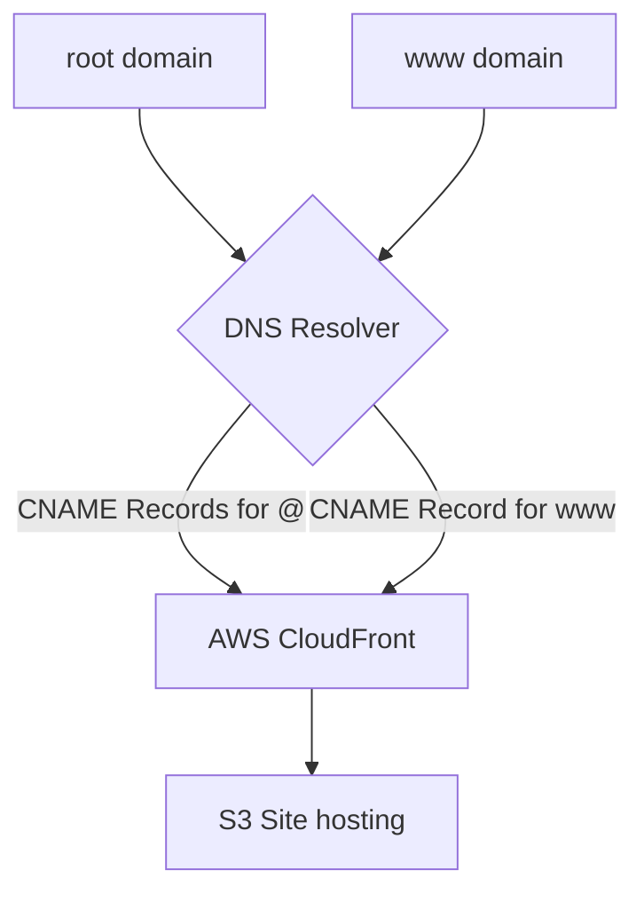

# Testing React on S3 Deployment with Cloudfront, Custom DNS
Reference: https://www.youtube.com/watch?v=mls8tiiI3uc&t=332s

### 1. Creating the template React app
Make sure you have npm or npx installed:

```
mkdir tutorials
cd tutorials
npx create-react-app demo_react_s3-app
```
Starting the app to check
```
npm start
```

Run production build - bundle everything into static files under /build
```
npm run build
```

### 2. S3 Site Hosting Set Up
#### 2.1. Site Hosting S3
- Create two buckets, both as your site name with and without www.
- Upload all files within /build onto the www. bucket
- Configure S3 Settings:
  - disable public access block
  - Edit bucket policy with the following permissions:
```
{
    "Version": "2012-10-17",
    "Statement": [
        {
            "Sid": "PublicReadGetObject",
            "Effect": "Allow",
            "Principal": "*",
            "Action": [
                "s3:GetObject"
            ],
            "Resource": [
                "arn:aws:s3:::Bucket-Name/*"
            ]
        }
    ]
}
```
- S3 Properties > enable S3 site hosting
  
#### 2.2. S3 Site Redirector set up
- go to other bucket without www. > properties > enable static website hosting > select redirect requests > point to other bucket name

### 3. Route 53/Custom Domain on Namecheap etc
Two methods:
1. Purchase a registered domain on Route 53 AWS
2. Purchase a registered domain from Non-AWS Provider (etc. Namecheap)

#### 3.1. Route 53 Example
- Purchasing registered domain on AWS will automatically create a hosted zone (for non www. S3)
- create record for hosted zone > simple routing > Define simple record for both S3 bucket sites
- Select alias to S3, select region bucket is in and bucket


If no use the basic http://<bucket_name>.s3-website-ap-southeast-1.amazonaws.com/

#### 3.2. Using custom domain (From Namecheap)
**Advanced DNS configuration:**
Point both of these to the cloudfront distribution domain using CNAME records (alias domains). If not using cloudfront, point to respective S3 site enabled buckets, 1 with the static site (www.propsights.site.s3-website-ap-southeast-1.amazonaws.com) and 1 redirector (propsights.site.s3-website-ap-southeast-1.amazonaws.com)
- @ - refers to root domain (xxx[.]com)
- www - refers to www domain (www[.]xxx[.]com)

With that the DNS query flow will be:



### 4. AWS Cloudfront - CDN
**Two methods:**
1. Keep public access to all files in S3 bucket, use its endpoint as origin (useful if you have many custom routings or redirects)
2. Use origin access identities to allow cloudfront to access S3 objects and use bucket as origin. ** PREFERED


#### Create Cloudfront Distribution
Creation of the Cloudfront distribution requires
1. Distribution domain name for Custom Domain to route towards
2. Origin to route traffic towards (etc. S3 Website endpoint, ELB, Http server)
3. TLS Certificates for HTTPs
   1. Requires you to input your AWS TLS Certificates into your custom domain registrar as CNAME records

**Steps:**
- Allocate the S3 WEBSITE endpoint as origin (http://www.propsights.site.s3-website-ap-southeast-1.amazonaws.com/)
- Add TLS certificates for both propsights.site and www.propsights.site
  - Copy the subdomain as name (www OR subdomain) and values of the alias target to the domain provider


- Now wait for AWS to validate the certificate after updating your domain registrar:


- This TLS certificate will now serve the domains propsights.site and www.propsights.site:


- Now replace the Bucket website link with the Cloudfront URL within your domain registrar advanced DNS configuration.

  - In this configuration, the cname records for TLS certificates are both assigned.


