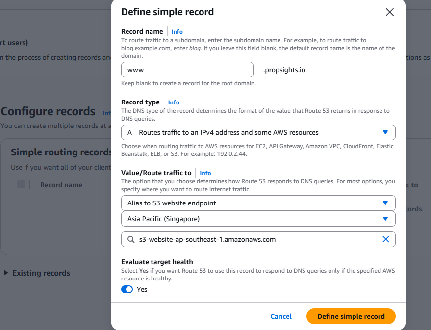
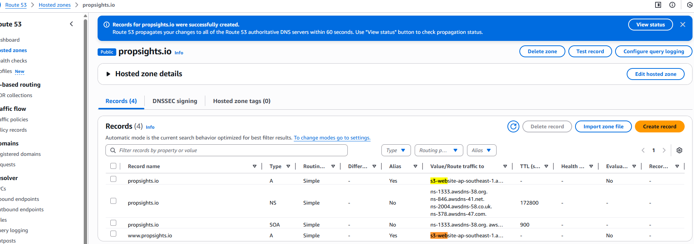

# Testing React on S3 Deployment
Reference: https://www.youtube.com/watch?v=mls8tiiI3uc&t=332s

### 1. Creating the template React app
Make sure you have npm or npx installed:

```
mkdir tutorials
cd tutorials
npx create-react-app demo_react_s3-app
```
Starting the app to check
```
npm start
```

Run production build - bundle everything into static files under /build
```
npm run build
```

### 2. S3 Site Hosting Set Up
#### Site Hosting S3
- Create two buckets, both as your site name with and without www.
- Upload all files within /build onto the www. bucket
- Configure S3 Settings:
  - disable public access block
  - Edit bucket policy with the following permissions:
```
{
    "Version": "2012-10-17",
    "Statement": [
        {
            "Sid": "PublicReadGetObject",
            "Effect": "Allow",
            "Principal": "*",
            "Action": [
                "s3:GetObject"
            ],
            "Resource": [
                "arn:aws:s3:::Bucket-Name/*"
            ]
        }
    ]
}
```
- S3 Properties > enable S3 site hosting
- 
#### S3 Site Redirector set up
- go to other bucket without www. > properties > enable static website hosting > select redirect requests > point to other bucket name

### 3. Route 53 
- create hosted zone (for non www. S3)
- create record for hosted zone > simple routing > Define simple record for both S3 bucket sites
- Select alias to S3, select region bucket is in and bucket


- Require a registered domain ($$$)
If no use the basic http://<bucket_name>.s3-website-ap-southeast-1.amazonaws.com/